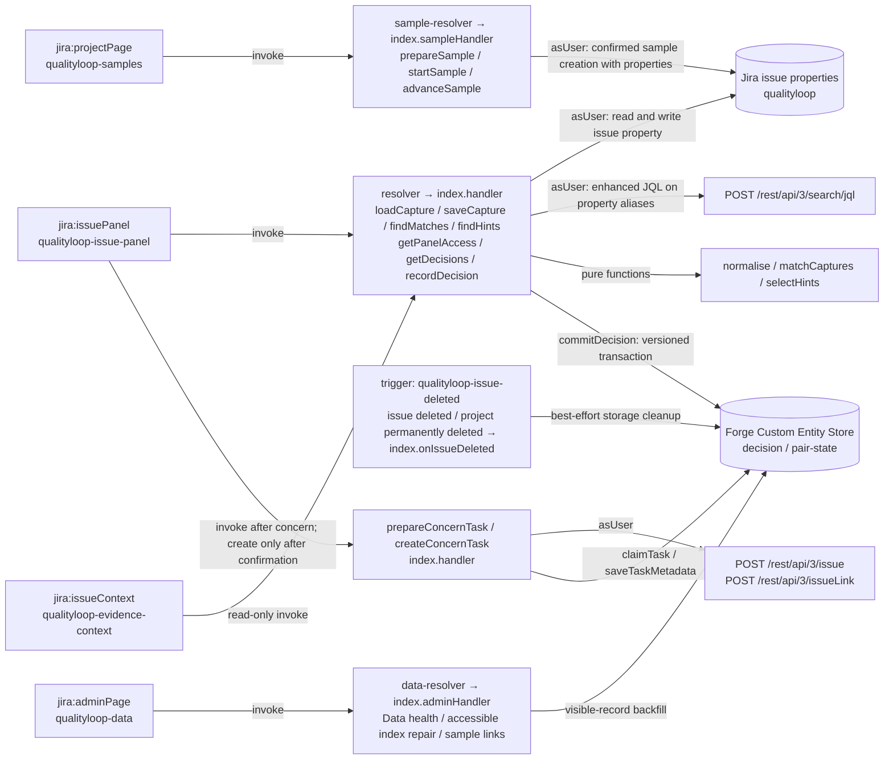

# QualityLoop

**Recurrence evidence for nonconformances in Jira: deterministic matching, viewing-user Jira access, and engineer decisions.**

After a successful nonconformance (NC) save in the issue panel, QualityLoop requests a search for corrective actions (CAPAs) using recorded failure fields and closure dates before the NC's detection date. It shows their evidence and records the engineer's decision.

QualityLoop presents possible recurrence evidence rather than declaring that a CAPA failed. Matching and decision recording do not change CAPA status; the optional sample scenario can attempt status transitions on sample CAPAs. The app does not fetch evidence-link contents; opening those links is a separate browser action.

> Built for Codegeist 2026, category **Apps for Specialized Industries**.

## What it does

| Step | What happens |
|---|---|
| **Capture** | An issue panel stores record type (NC or CAPA), part number, failure mode, supplier, line, dates and an effectiveness-evidence link in one issue property (`qualityloop`). |
| **Match** | After a successful NC panel save, Jira is searched *as the viewing user*, within the NC project's configured scope and look-back window (defaults: this project only, 365 days). Strong matches require the same normalised part number and failure mode, with a recorded QualityLoop closure date 1–N days before detection; Jira status does not establish closure. An otherwise eligible different revision of the same base part is shown separately as a related revision. |
| **Inspect** | Each card shows the matched fields, closure date, days since closure and whether effectiveness evidence was recorded. Strong and revision cards warn when Jira is outside the Done category. The most recent 25 of each class are displayed, with omitted visible matches disclosed. |
| **Hints** | "Not matched — check these" can show up to three hints from limited searches: near-identical part numbers, CAPAs with no closed date and older precedents, with the same normalised failure mode. These are never treated as matches. |
| **Decide** | The engineer records Engineer-confirmed recurrence, Not a recurrence (with a category) or Effectiveness concern. A confirmed follow-up includes a description with the NC linked using the Jira site URL (or plain text when the site URL is unavailable), reason and safe evidence, plus Relates links to both NC and CAPA. The dialog names the selected issue type and intended assignee. Task is preferred; the first non-subtask standard type is the fallback. Missing Relates permits explicitly confirmed unlinked creation. Partial results retain the task key and offer Verify link to repair the empty description and missing links without creating another issue. Interrupted creates retain the separate, confirmed task-key recovery flow. |

### Decision states

- **Possible recurrence:** the system shows a match based on recorded fields only.
- **Engineer-confirmed recurrence:** an explicit human decision, with a reason.
- **Not a recurrence:** an explicit human decision, with a category.
- **Effectiveness concern:** allowed when the pair's current state is Engineer-confirmed recurrence, or when the CAPA has no effectiveness-evidence URL. It can create a re-review task after the user confirms the listed writes.

Decision explanations are appended rather than overwritten; follow-up metadata can be updated and cleanup can delete records. This is not an immutable audit trail; no certification claim is made here.

Decision loading uses at most five concurrent CAPA loads and shares issue, user and pair-state reads within each invocation. A legacy confirmation flag is persisted with a version condition when first derived. Follow-up recovery never creates another task; older claims without a recorded claim time require a manual Jira check. The side view still uses **Refresh evidence and decisions** after a panel change because UI Kit cross-module event emission could not be established from the Forge documentation. See [T15](docs/tasks/T15.md) for validation, simulated call counts, production dependency findings and the owner checklist.

## Try it

1. On a Jira Cloud site with QualityLoop already installed, open a project where you can create issues.
2. In the **project navigation → QualityLoop** page, click **Create sample scenario (5 issues)**. Review and confirm the listed writes. Creation can fail or leave a partial scenario; the plan includes a sample link and attempted Done-category transitions on the sample CAPAs.
3. When ready, open the linked new sample NC and click **Save** in its **qualityloop** issue panel, with Edit Issues permission.
4. Review the evidence and any hints, then record a decision. The sample does not guarantee a hint will be shown.

The repository's owner click/check sequence is in [T10.md](docs/tasks/T10.md).

## Screenshots

Screenshots will be captured from the development site later. These are planned
file paths, not available images:

| View | Placeholder path |
|---|---|
| NC capture and recurrence evidence | `docs/screenshots/issue-panel.png` |
| Expanded hints and their disclaimer | `docs/screenshots/hints.png` |
| Engineer decision and follow-up confirmation | `docs/screenshots/follow-up.png` |
| Project sample walkthrough | `docs/screenshots/project-page.png` |

## Architecture



- **Modules:** `jira:issuePanel`, `jira:issueContext`, `jira:projectPage`, `jira:adminPage`, `jira:entityPropertySet` (aliases `qlRecordType`, `qlPart`, `qlPartBase`, `qlFailureMode`, `qlSupplier`, `qlSupplierNorm`, `qlDetected`, `qlClosed`), and one deletion trigger subscribed to issue deletion and permanent project deletion. Project trash is not subscribed.
- **Scopes:** `read:jira-work`, `write:jira-work`, `storage:app`, `read:jira-user`.
- **Hosting configuration:** no external egress permission or LLM dependency is declared. On **13 Nov 2026**, `forge deploy -e development` (app version **6.15.0 and later**) reported that the app is **"eligible for the Runs on Atlassian program"** (owner-observed deployment output). This records the dated CLI eligibility result; no Marketplace badge or certification is claimed. See the [eligibility requirements and CLI checks](https://developer.atlassian.com/platform/forge/runs-on-atlassian-apps/).

## Permissions model

- User-facing Jira reads and writes use `asUser()`. Forge app-storage accesses are guarded by resolver permission checks.
- The current issue ID comes from the resolver context, never from the frontend. Payload CAPA issue IDs are fetched as the user before stored pair/decision data is used; unexpected current-issue IDs are rejected.
- Before returning candidate, history or count data, resolvers fetch the referenced issues as the user and omit denied or missing issues.
- Users who can browse the issue but lack Edit Issues permission get a read-only panel.
- A versioned transaction rejects a stale decision save; on a conflict, the panel requests refreshed state/history rather than overwriting it.

## Matching rules

### Project search settings

Open a project's **QualityLoop** tab: **How to try this** comes first, followed
by **Sample scenario** controls and links, then **Search settings** last. Anyone
who can browse the project can see its settings. Changes require either
**Administer Projects** on that exact project or global **Jira administrator**
permission, checked as the acting user in the resolver. The site-wide failure-mode
catalogue continues to require Jira administrator permission.

- **This project only** is the default. It keeps the default DEMO sample scoped
  to its own project even if another project has identical DEMO part numbers.
- **This project + listed projects** includes the NC's project and up to 20
  additional project keys entered with spaces or commas. The server validates
  that the keys exist and are browsable by the admin, then stores stable project
  IDs. Unknown/inaccessible keys produce a clear error without revealing whether
  an inaccessible project exists. Only listed project keys the current viewer
  can browse are displayed or included in searches. Saving replaces the list.
- **All projects I can browse** searches with the viewing user's Jira access.
  It never grants project or issue-security access.
- **Look-back window:** 90, **365 (default)**, 730 or 1095 days. The eligible
  range is 1 through the selected number of days before detection, inclusive.

Settings live at installation-scoped KVS `settings:<projectId>` with scope,
listed project IDs, lookbackDays and an edit revision. The **NC's project**
selects the settings, including for CAPAs in another project. Match,
other-related and hint JQL, fresh in-memory classification, and the decision
resolver's eligibility recheck all use them. Listed queries include a quoted
`project in (...)` restriction; all-project searches rely on asUser access.
Invalid/unavailable settings fail closed rather than widening a search.

Project settings contain scope, project IDs, window and revision, not issue
content. The existing Data health cleanup handles NC/CAPA decision records, not
these settings keys; a deleted project's settings may remain in KVS.

Evidence headings in the panel and side view show the applied scope and window.
Local-only searches with no strong/revision match explain how a project admin
can widen the search. Hints use the configured window; older-precedent hints
remain clearly outside that window. Refresh evidence on open NCs after changing
settings. Existing decision history remains visible subject to browse access,
even when its CAPA is no longer in the current matching scope.

The pure evaluation keeps its fixed 365-day default and does not load site KVS
settings; frozen data and the reported evaluation remain unchanged. Historical
CAPA import is deferred.

### Site failure-mode catalogue

The default seed in `src/config/failureModes.js` follows the synthetic automotive
plant story used by the evaluation: FM-01 Crack, FM-02 Burr, FM-03 Dimension out
of tolerance, FM-04 Porosity, FM-05 Corrosion, FM-06 Missing feature and FM-07
Surface damage. FM-99 Other remains the app's additional default code. The DEMO
uses FM-01, FM-07 and FM-03 from this seed; CAPA-B's story is handling-pad surface
damage. Frozen evaluation JSON has not changed. Existing sample narratives are
not rewritten; recreate a disposable sample if you want the updated story.

Jira administrators can open **QualityLoop data → Failure-mode catalogue** to
list, add, rename labels, deactivate or reactivate codes. The catalogue is
site-wide across projects, stored as `{ version, modes: [{ code, label, active }] }`
at installation-scoped KVS key `fm-catalog:site`. Only global **Administer Jira**
(`ADMINISTER`) permits changes; project administration alone does not. Codes
are trimmed/uppercased, must match `^[A-Z0-9][A-Z0-9_-]{0,31}$`, and cannot be
deleted or reused. The 50-code limit includes inactive codes. The seed is used
when the KVS key is absent; a storage error or malformed catalogue blocks writes
instead of substituting defaults. Refresh open issue panels after editing.

Capture selects and both client/server validation offer active codes plus the
record's existing stored code. An existing record can keep its code after
deactivation while other fields are edited, or switch to an active code. New
records and switches to a different inactive code are rejected. The server
compares with the property it reads from Jira, never a client-supplied exception.
New saves persist canonical codes, not labels. Labels remain visible everywhere:
`FM-08 Wire fracture (inactive)`; only absent codes show
`FM-08 (not in catalogue)`. A valid stored code missing from the catalogue can
also be retained when editing. Forms and compact admin rows sort by code.
Changing a label does not change a signature or rewrite existing records.
Concurrent admin edits use a lock and revision check; refresh after a conflict
or uncertain save rather than overwriting another edit.

### Normalisation and migration

1. Normalisation trims whitespace, collapses inner whitespace and converts to uppercase. Part numbers additionally follow the named rule **spaces around hyphens are removed**: `SM-6604 -A` and `SM-6604-A` are equal after normalisation. This is deterministic formatting normalisation, not fuzzy matching; failure-mode text normalisation is unchanged. `partOriginal` preserves the input part number, and cards use it for display.
2. The current revision pattern is a trailing `-<1–2 letters>` suffix of the normalised part. An otherwise eligible different revision of the same base part, with the same failure mode, is a **related revision**, never an exact match.
3. A strong or related-revision match needs a recorded QualityLoop closed date between 1 and the NC project's lookbackDays (365 by default) before detection, within its configured project scope. Jira status is not a matching gate.
4. Supplier and line do not affect strong or related-revision matches. Supplier can affect **Other related records**; line supplies supporting facts.
5. Strong and related-revision matching use no fuzzy comparisons. Limited, labelled hints can surface some part-number typos; they do not cover every typo.

6. Capture schema **v3** stores `supplierNorm` and `lineNorm`: trim, collapse
   whitespace, uppercase. Supplier/line equality and supporting facts use these
   normalised values while displaying the original strings. The matcher computes
   them from originals in memory for every record, including schema v1/v2 and
   direct property edits with stale stored norms. Blank values are not evidence
   of equality. `failureMode` is also saved and queried as a canonical code.

JQL on `qlSupplierNorm` (`supplierNorm`) only covers records saved after this
change. Older CAPAs can be missed by the supplier-based **Other related** search
until re-saved; a short note under **QualityLoop data → App data maintenance**
discloses this limit. There is no automatic
backfill or global migration. Strong/related-revision matching does not depend
on supplier or line. The legacy `qlSupplier` alias is retained; the application
now uses `qlSupplierNorm` for that search branch. Old noncanonical failure codes
written directly into Jira can still be missed by JQL until re-saved canonically.

Existing stored CAPAs keep their old `partNorm` and `partBase` until re-saved; the matcher re-normalises `partOriginal` in memory once a record is fetched, but JQL on `qlPartBase` can still miss older records saved with a trailing-space base, so open and re-save affected CAPAs to refresh those stored fields.

## Evaluation

The evaluation lives in [`eval/`](eval/README.md). The local dev run uses 24 CAPAs and 18 NCs. Dataset documentation describes synthetic data from a fictional plant, 60 NCs in total (including 42 held-out cases), and mechanism-based labels. Held-out contents and results were not inspected here.

- `eval/FROZEN.json` records a freeze date of 2026-11-01 and SHA-256 hashes. The scorer verifies the selected split's inputs and shared corpus against those hashes. The repository snapshot does not establish the historical order of freezing, harness development or test-split custody.
- The scorer in `eval/reference/score.js` shares no code with the app.

| Metric | Dev (18 NCs) | Test (42 NCs) |
|---|---|---|
| Signature correctness (L1) | 18/18 | TODO |
| Pair recall | 0.875 | TODO |
| Recall including hints | 0.938 | TODO |
| Pair precision | 0.737 | TODO |
| Review cards per NC (avg / max) | 1.11 / 2 | TODO |

These are synthetic pure-logic harness results, not live Jira or field performance. The scorer prints every missed TRUE pair with its dataset trap category.

To run the evaluation:

```
npm run eval:dev
```

## Data and privacy

New capture and decision evidence links must use HTTPS, with a hostname, no credentials, no surrounding spaces or control characters, and at most 2,000 characters. Validation messages explain whether to remove credentials or surrounding spaces, use HTTPS, or enter a full HTTPS URL. Stored valid HTTPS links remain clickable; legacy HTTP links remain visible as plain text with a styled **Not a secure link (http)** warning. Malformed or credentialed stored URLs show **Invalid evidence link** and are never clickable. Editing a CAPA with an old HTTP link keeps that value in the form and requires the engineer to correct it before saving; the app does not silently drop, rewrite or migrate links.

QualityLoop stores QualityLoop fields in Jira issue properties, and decisions in Forge app storage. Opening an evidence link is a separate browser action. Whole-project data is removed following permanent project deletion when cleanup checks succeed, or through confirmed admin Data health removal. **Trashed projects keep their QualityLoop data**, including after restoration. The soft-delete subscription is removed and queued soft-delete events are ignored. Individual issue deletion and confirmed sample removal retain their existing cleanup. Permanent-project events carry no child issue IDs and do not emit child issue-deleted events, so the existing cleanup checks stored references globally with an 18-second read budget and the trash protection below.

Jira admins can open **QualityLoop data → Data health**, click **Check for orphaned records**, then **Remove orphaned records** and confirm the displayed count. The check scans both record entities in ten-record pages, with a 12-second read budget per invocation and at most 20 pages per browser action. Resume controls continue unfinished checks and confirmed removals using account-bound tickets valid for one hour; a page reload, expired ticket, invalid cursor or pre-trash-protection ticket requires a new check. It uses `asApp()` only for issue-existence status, never issue content, and the acting Jira admin's `asUser()` access for the project-trash check. Only counts and app record IDs are returned. Counting or deleting an orphan requires a fresh issue 404 plus reliable exclusion of projects in trash. The result text explains that uncertain records are not counted and are retained. A 403 or other error alone never permits deletion. Existing accessible-record index repair still uses `asUser()`.

Limitations: missing issues cannot be reliably mapped to their project from stored IDs. QualityLoop conservatively retains **all** missing-issue records if any project is in trash or a complete empty-trash result cannot be verified. The project search uses `status=deleted`, meaning the recycle bin. Permanent-event cleanup also verifies the app principal has global `ADMINISTER` before trusting that search; without it, missing records are retained for the admin check. No additional scope or admin permission is granted to the app. These checks are repeated before removal. Event delivery, eventual storage indexes, permissions and budgets can leave records behind; re-run Data health when trash can be excluded. Get issue still requires app Browse projects/issue-security access, so 404 remains an imperfect deletion signal even when trash is excluded. An interrupted progress write after a successful removal may under-report the count, while replay remains safe. No Jira issues are changed by Data health. See [PRIVACY.md](PRIVACY.md) and [T22.md](docs/tasks/T22.md).

## Development

```
npm ci
npm test
npm run eval:dev
forge deploy -e development
forge install -e development --site <site>.atlassian.net --product jira
```

Coding-agent rules are in [AGENTS.md](AGENTS.md).

### T28 panel update for existing installations

The issue-panel module is now `qualityloop-issue-panel`, with an original SVG
comparison motif bundled as `resource:qualityloop-icons;qualityloop.svg`. No
external image host or new scope is required. Issue properties (`qualityloop`),
decision/pair-state entities, resolver names and frontend resources retain their
existing identities; none stores or looks up the former panel module key.

Save any pending form edits before the owner deploys this update. Treat the
renamed module as a new panel: reload already-open issue views, then choose
**Apps → QualityLoop** again if needed. Old panel expansion/pinning is not
migrated by this app. The exact Jira behavior for an already-open panel during a
key rename is not documented and must be checked live.

Owner commands for the installed development site (select its existing Jira
installation when prompted):

```powershell
forge deploy -e development
forge install --upgrade -e development --product jira
```

The [versioning rules](https://developer.atlassian.com/platform/forge/versions/)
automatically apply minor updates within an installed major version. They do not
list panel-key/icon changes as requiring a major version or an uninstall. The
[install command](https://developer.atlassian.com/platform/forge/cli-reference/install/)
supports upgrading the existing installation; do not uninstall/reinstall for this
change. If it is already current after automatic deployment, reload and check the
panel. There is no documented panel-key-specific migration guarantee.

After development review and live testing, the owner must repeat the deployment
and upgrade on **production**, selecting each existing production Jira site:

```powershell
forge deploy -e production
forge install --upgrade -e production --product jira
```

For a genuinely fresh test site, deploy first, then run
`forge install -e development --product jira` and select that site. Verify the
custom icon and panel on both an existing issue and a newly opened issue.

File-and-line evidence and every README correction are recorded in [T11.md](docs/tasks/T11.md).

Clean-install output, repository hygiene changes and stable dependency recommendations are recorded in [T13.md](docs/tasks/T13.md). Licensed under [MIT](LICENSE).

Bounded evidence loading, current distinct-NC recurrence counts, SIMULATED scale call counts, and the owner-run REAL benchmark instructions are recorded in [T14.md](docs/tasks/T14.md).
