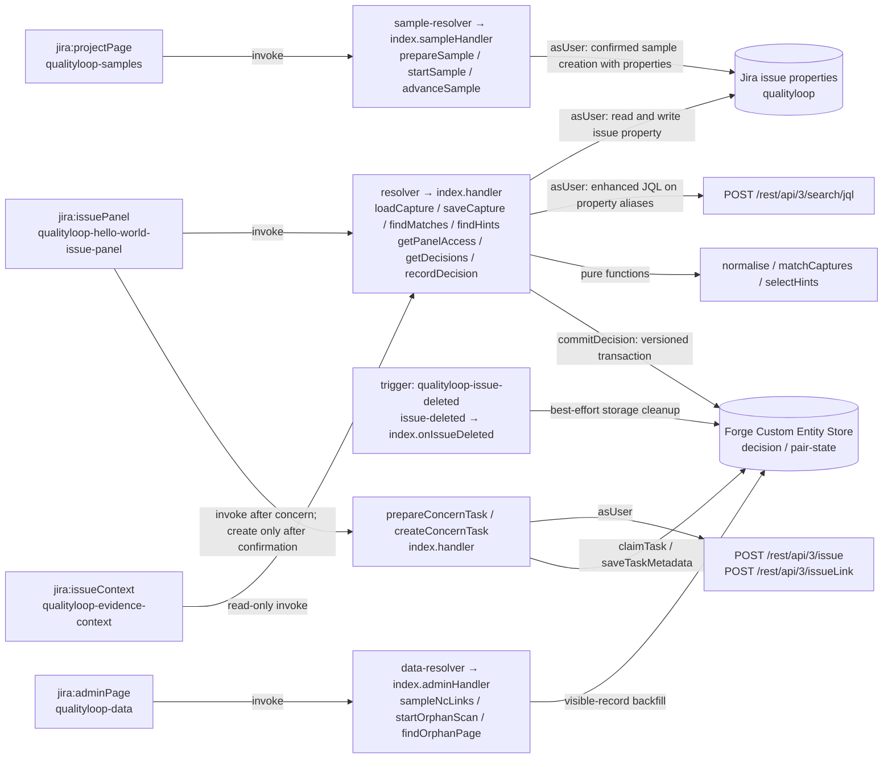

# QualityLoop

**Recurrence evidence for nonconformances in Jira: deterministic matching, viewing-user Jira access, and engineer decisions.**

After a successful nonconformance (NC) save in the issue panel, QualityLoop requests a search for corrective actions (CAPAs) using recorded failure fields and closure dates before the NC's detection date. It shows their evidence and records the engineer's decision.

QualityLoop presents possible recurrence evidence rather than declaring that a CAPA failed. Matching and decision recording do not change CAPA status; the optional sample scenario can attempt status transitions on sample CAPAs. The app does not fetch evidence-link contents; opening those links is a separate browser action.

> Built for Codegeist 2026, category **Apps for Specialized Industries**.

## What it does

| Step | What happens |
|---|---|
| **Capture** | An issue panel stores record type (NC or CAPA), part number, failure mode, supplier, line, dates and an effectiveness-evidence link in one issue property (`qualityloop`). |
| **Match** | After a successful NC panel save, Jira is searched *as the viewing user*. Strong matches require the same normalised part number and failure mode, with a recorded QualityLoop closure date 1–365 days before detection; Jira status does not establish closure. An otherwise eligible different revision of the same base part is shown separately as a related revision. |
| **Inspect** | Each card shows the matched fields, closure date, days since closure and whether effectiveness evidence was recorded. |
| **Hints** | "Not matched — check these" can show up to three hints from limited searches: near-identical part numbers, CAPAs with no closed date and older precedents, with the same normalised failure mode. These are never treated as matches. |
| **Decide** | The engineer records Engineer-confirmed recurrence, Not a recurrence (with a category) or Effectiveness concern. A follow-up task is created only after a confirmation dialog that lists it. |

### Decision states

- **Possible recurrence:** the system shows a match based on recorded fields only.
- **Engineer-confirmed recurrence:** an explicit human decision, with a reason.
- **Not a recurrence:** an explicit human decision, with a category.
- **Effectiveness concern:** allowed when the pair's current state is Engineer-confirmed recurrence, or when the CAPA has no effectiveness-evidence URL. It can create a re-review task after the user confirms the listed writes.

Decision explanations are appended rather than overwritten; follow-up metadata can be updated and cleanup can delete records. This is not an immutable audit trail; no certification claim is made here.

## Try it

1. On a Jira Cloud site with QualityLoop already installed, open a project where you can create issues.
2. In the **project navigation → QualityLoop** page, click **Create sample scenario (5 issues)**. Review and confirm the listed writes. Creation can fail or leave a partial scenario; the plan includes a sample link and attempted Done-category transitions on the sample CAPAs.
3. When ready, open the linked new sample NC and click **Save** in its **qualityloop** issue panel, with Edit Issues permission.
4. Review the evidence and any hints, then record a decision. The sample does not guarantee a hint will be shown.

The repository's owner click/check sequence is in [T10.md](docs/tasks/T10.md).

## Architecture



- **Modules:** `jira:issuePanel`, `jira:issueContext`, `jira:projectPage`, `jira:adminPage`, `jira:entityPropertySet` (aliases `qlRecordType`, `qlPart`, `qlPartBase`, `qlFailureMode`, `qlSupplier`, `qlDetected`, `qlClosed`), and an issue-deleted trigger.
- **Scopes:** `read:jira-work`, `write:jira-work`, `storage:app`, `read:jira-user`.
- **Hosting configuration:** no external egress permission or LLM dependency is declared. Runs on Atlassian eligibility has not been verified here.

## Permissions model

- User-facing Jira reads and writes use `asUser()`. Forge app-storage accesses are guarded by resolver permission checks.
- The current issue ID comes from the resolver context, never from the frontend. Payload CAPA issue IDs are fetched as the user before stored pair/decision data is used; unexpected current-issue IDs are rejected.
- Before returning candidate, history or count data, resolvers fetch the referenced issues as the user and omit denied or missing issues.
- Users who can browse the issue but lack Edit Issues permission get a read-only panel.
- A versioned transaction rejects a stale decision save; on a conflict, the panel requests refreshed state/history rather than overwriting it.

## Matching rules

1. Normalisation trims whitespace, collapses inner whitespace and converts to uppercase. `partOriginal` preserves the input part number, and cards use it for display.
2. The current revision pattern is a trailing `-<1–2 letters>` suffix of the normalised part. An otherwise eligible different revision of the same base part, with the same failure mode, is a **related revision**, never an exact match.
3. A strong or related-revision match needs a recorded QualityLoop closed date between 1 and 365 days before the NC's detection date. Jira status is not a matching gate.
4. Supplier and line do not affect strong or related-revision matches. Supplier can affect **Other related records**; line supplies supporting facts.
5. Strong and related-revision matching use no fuzzy comparisons. Limited, labelled hints can surface some part-number typos; they do not cover every typo.

## Evaluation

The evaluation lives in [`eval/`](eval/README.md). The local dev run uses 24 CAPAs and 18 NCs. Dataset documentation describes synthetic data from a fictional plant, 60 NCs in total (including 42 held-out cases), and mechanism-based labels. Held-out contents and results were not inspected here.

- `eval/FROZEN.json` records a freeze date of 2026-11-01 and SHA-256 hashes. The scorer verifies the selected split's inputs and shared corpus against those hashes. The repository snapshot does not establish the historical order of freezing, harness development or test-split custody.
- The scorer in `eval/reference/score.js` shares no code with the app.

| Metric | Dev (18 NCs) | Test (42 NCs) |
|---|---|---|
| Signature correctness (L1) | 18/18 | TODO |
| Pair recall | 0.813 | TODO |
| Recall including hints | 0.938 | TODO |
| Pair precision | 0.722 | TODO |
| Review cards per NC (avg / max) | 1.06 / 2 | TODO |

These are synthetic pure-logic harness results, not live Jira or field performance. The scorer prints every missed TRUE pair with its dataset trap category.

To run the evaluation:

```
npm run eval:dev
```

## Data and privacy

QualityLoop stores QualityLoop fields in Jira issue properties, and decisions in Forge app storage. Opening an evidence link is a separate browser action. Issue-deletion handling makes a best-effort attempt to clean associated app records; confirmed sample removal also cleans records for successfully deleted samples. Manual orphan deletion is disabled. See [PRIVACY.md](PRIVACY.md).

## Development

```
npm ci
npm test
npm run eval:dev
forge deploy -e development
forge install -e development --site <site>.atlassian.net --product jira
```

Coding-agent rules are in [AGENTS.md](AGENTS.md).

File-and-line evidence and every README correction are recorded in [T11.md](docs/tasks/T11.md).

Clean-install output, repository hygiene changes and stable dependency recommendations are recorded in [T13.md](docs/tasks/T13.md). Licensed under [MIT](LICENSE).

Bounded evidence loading, current distinct-NC recurrence counts, SIMULATED scale call counts, and the owner-run REAL benchmark instructions are recorded in [T14.md](docs/tasks/T14.md).
